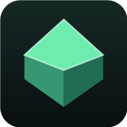
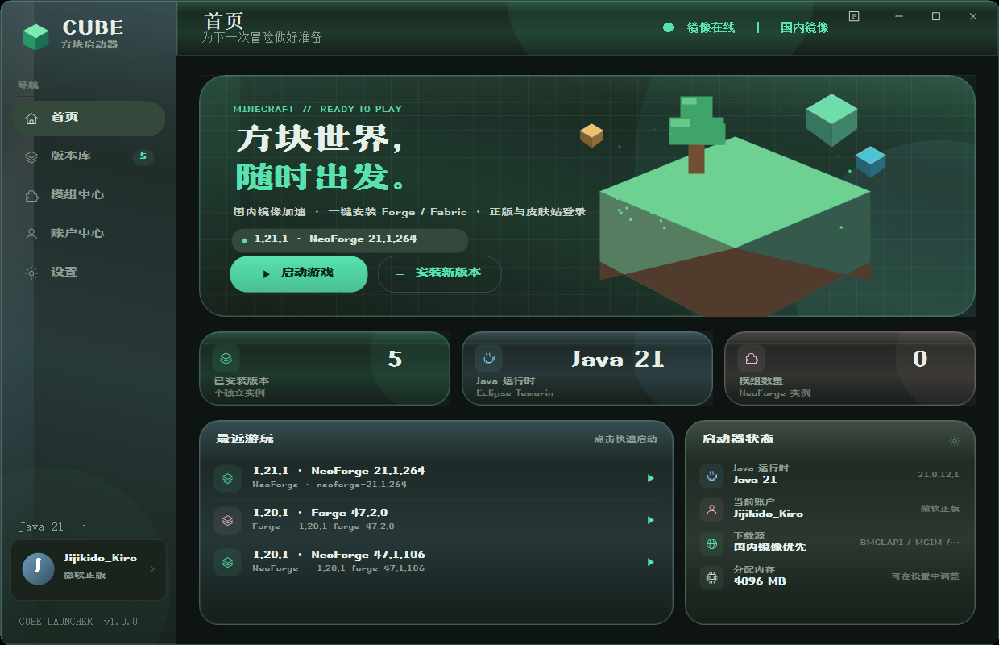
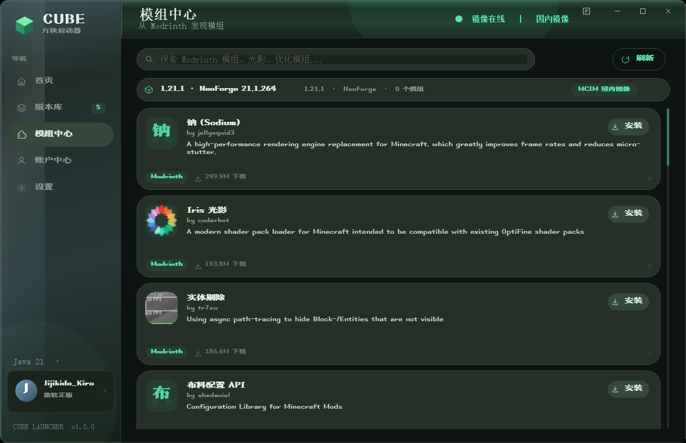
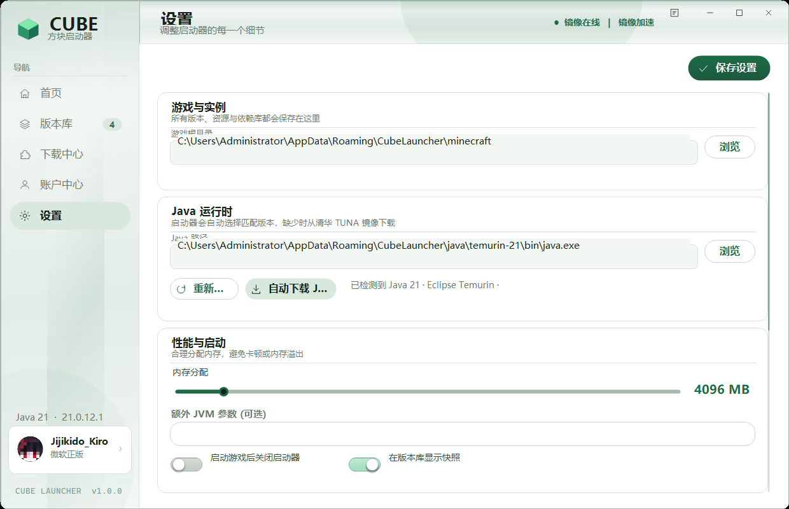

# 方块启动器 CubeLauncher

一个面向 Windows 的 Minecraft 启动器，目标是在 **.NET Framework 4.0** 上提供现代、顺滑的体验：下载原版与模组加载器、连接 Modrinth、支持微软正版 / 第三方皮肤站 / 离线账户、自动下载 Java，并用国内镜像优先的方式完成所有网络请求。



> [!NOTE]
> 模组下载仅支持 **Modrinth**；CurseForge 下载通道已移除。

## 界面预览

| 首页 | 模组中心 |
| --- | --- |
|  |  |


## 功能

- **全版本安装**：从 Mojang 版本清单读取 900+ 个正式版 / 快照 / 远古版本，安装客户端、依赖库、资源索引与全部资源文件。
- **模组加载器**
  - Fabric：从 Fabric Meta 获取 Loader 列表，自动安装 Loader、Intermediary 与依赖。
  - Forge：从 Forge Maven 获取全部构建，下载官方安装器并通过 `--mirror` 让安装器优先使用 BMCLAPI。
  - NeoForge：从 NeoForged CDN 获取版本与安装器，20.4/1.21.1 及 1.20.1 旧版 47.1 均可安装，自动预下载依赖。
  - Quilt：从 Quilt Meta 安装，兼容 Fabric 模组生态。
- **两大模组站**
  - Modrinth 搜索、项目详情、版本文件选择、一键安装。
  - 搜索结果中的模组名称与简介会自动翻译为中文（MyMemory，带内存缓存）；网络不可用时保留英文，不影响搜索。
  - 支持 Modrinth 的 WebP 封面；通过 Windows WIC 解码，不依赖额外图片库。
  - 通过 MCIM 国内镜像读取元数据并下载文件；必需前置模组自动安装。
- **账户系统**
  - 微软正版：微软官方设备代码登录，Xbox Live / XSTS / Minecraft Services，支持正版皮肤与披风。
  - 第三方皮肤站：兼容 authlib-injector / Yggdrasil，内置 LittleSkin 预设，启动时自动注入皮肤。
  - 离线账户：本地生成离线 UUID，适合单机、局域网与测试。
  - 令牌使用 Windows DPAPI 加密保存。
- **自动 Java**：检测系统 Java；缺失时从清华 TUNA 的 Adoptium 目录下载 Temurin JDK，自动解压到启动器目录。
- **启动**：解析版本继承、规则、参数占位符、natives 解压、资源对象、日志配置、authlib-injector，支持 Forge 的模块路径参数。
- **前置修复**：Forge 使用基础版本名替换 `${version_name}`，确保 `-DignoreList` 包含 `1.20.1.jar`，避免模块重复导出崩溃；Fabric/Quilt 检测到模组但缺少 Fabric API 时，启动前自动安装兼容版本。
- **界面**：Material 3 Expressive 风格深色主题；大圆角卡片、胶囊按钮/导航、绿色主色与粉/蓝点缀，保留液态玻璃高光与动画。
- **液态玻璃与动效**：半透明玻璃卡片、缓慢流动的高光/焦散、侧栏流光、窗口淡入、页面切换幕布、按钮悬停缓动、Toast 淡入淡出。
- **滑动动画**：切页从下方 14px 上滑淡入；左侧导航高亮块以 BackEase 回弹滑到目标项；分段按钮的选中滑块平滑移动。
- **字体**：上首标题宋体已作为资源编译进 `CubeLauncher.exe`，运行时无需安装字体，也不需要额外的字体文件；源码中的 `assets/fonts/ShangShouBiaoTiSong.ttf` 仅用于构建。

## 国内镜像优先

默认设置下，所有请求按以下顺序执行：

| 内容 | 首选 | 回退 |
| --- | --- | --- |
| 版本清单 / 版本 JSON | BMCLAPI | Mojang Piston |
| 客户端、依赖库 | BMCLAPI | Mojang / Maven |
| 资源对象 | BMCLAPI `/assets` | Mojang `resources.download.minecraft.net` |
| Forge 安装器 / 库 | BMCLAPI Forge / Maven | Forge 官方 Maven |
| NeoForge 安装器 / 库 | NeoForged CDN / BMCLAPI Maven | NeoForge 官方 Maven |
| Fabric Meta / 库 | BMCLAPI `/fabric-meta`、`/maven` | Fabric 官方 |
| Modrinth | MCIM (`mod.mcimirror.top`) | Modrinth 官方 |
| Java | 清华 TUNA Adoptium | Adoptium API |
| authlib-injector | BMCLAPI 镜像 | 官方 |

可在「设置 → 下载与镜像」关闭“国内镜像优先”，全部改为官方源优先。

## 使用

1. 双击 `CubeLauncher.exe`。
2. 在「版本库 → 安装新版本」选择 Minecraft 版本和加载器。
3. 在「账户中心」添加微软正版、皮肤站或离线账户。
4. 回到首页点击「启动游戏」。首次启动会自动补齐资源与 Java。

### 微软登录

启动器使用微软官方 **设备代码（Device Code）** 流程：

1. 点击「开始微软登录」，启动器自动打开 `https://www.microsoft.com/link` 并显示一次性代码；
2. 在浏览器中输入代码，选择微软账户并授权；
3. 启动器轮询完成后自动进入 Xbox Live → XSTS → Minecraft Services → 档案读取。

默认使用 Prism Launcher 的公共客户端 ID `c36a9fb6-4f2a-41ff-90bd-ae7cc92031eb`（已获 Minecraft Services 权限，无客户端密钥）。如需替换，可修改 `%APPDATA%\CubeLauncher\config.json` 的 `MicrosoftClientId`。

> 如果提示 Xbox 401，请先确认浏览器中已显示“授权成功”，并重新点击「开始微软登录」获取新代码；不要复用旧代码。启动器不会保存微软密码。


### 第三方皮肤站

默认填入 LittleSkin：`https://littleskin.cn/api/yggdrasil`。其他皮肤站请填写其 **Yggdrasil API 根地址**，例如 `https://example.com/api/yggdrasil`。启动器会：

- 读取站点 metadata 并校验；
- 把 metadata 以 Base64 写入 `-Dauthlibinjector.yggdrasil.prefetched`；
- 使用 `-javaagent:authlib-injector.jar=<API 地址>` 启动游戏。

### 离线账户

用户名需为 3–16 位字母、数字或下划线。离线 UUID 使用与 Java `UUID.nameUUIDFromBytes("OfflinePlayer:" + name)` 一致的算法。

## 目录

```
%APPDATA%\CubeLauncher\
├─ config.json                 # 设置与账户（令牌为 DPAPI 密文）
├─ logs\launcher.log           # 启动器日志
├─ cache\                      # 版本 JSON、Forge 安装器、authlib-injector
├─ java\                       # 自动下载的 Temurin JDK
└─ minecraft\
   ├─ versions\                # 版本 JSON / 客户端 jar
   ├─ libraries\               # Maven 依赖
   ├─ assets\                  # 资源索引与对象
   └─ instances\<版本>\        # 每个实例独立的 mods / saves / options.txt
```

## 构建

要求：Windows + .NET Framework 4.0（系统自带 `csc.exe`），不需要 Visual Studio 或 NuGet。

```powershell
powershell -ExecutionPolicy Bypass -File .\build.ps1
```

产物：

```
dist\CubeLauncher.exe
release\CubeLauncher-1.0.0-win64.zip
```

`build.ps1` 使用：

```
C:\Windows\Microsoft.NET\Framework64\v4.0.30319\csc.exe
```

目标框架为 .NET Framework 4.0，C# 5 语法，无第三方 DLL。

## 已知限制

- 微软登录使用设备代码流程和 Prism Launcher 的公共客户端 ID；如果微软调整权限策略，可在 `config.json` 中替换为自己的 Azure 公共客户端 ID。
- CurseForge 下载通道已彻底移除，模组来源仅保留 Modrinth。
- Fabric 启动前自动补装 Fabric API 仅针对检测到“非 Sodium”模组且没有 API 的情况；如果手动安装了错误版本，请删除旧 API 后重试。
- Forge 安装依赖官方安装器执行映射合并与二进制补丁；安装器本身从 BMCLAPI 下载，库优先走 BMCLAPI，失败时回退官方。
- 仅支持 Windows。Java 版本按版本 JSON 的 `javaVersion.majorVersion` 选择（通常 8 / 17 / 21）。
- NeoForge 安装器、Maven 元数据与依赖优先走 `neoforged.forgecdn.net`，再回退 BMCLAPI / 官方 Maven。20.4 的 JarJarFileSystems 0.4.0 可直接从该 CDN 获取，不再需要修补安装器。
- NeoForge 1.20.1 属于旧的 `net.neoforged:forge 1.20.1-47.1.x` 构建，启动器已适配该版本命名；1.20.2+ 走 `net.neoforged:neoforge`。
- 资源文件数量约 3000+，首次安装需要几分钟；之后会按 SHA1 校验并跳过。

## 安全说明

- 不保存微软或皮肤站密码，只保存 OAuth / Yggdrasil 令牌。
- 令牌使用 `ProtectedData`（当前用户 DPAPI）加密。
- 所有下载文件尽可能使用 SHA1 校验；Maven 元数据缺失校验值时按大小校验。
- 日志中不会输出 access token。

## 许可

MIT License。Minecraft 是 Mojang Studios 的商标，本项目与 Mojang / Microsoft 无关联。Forge、NeoForge、Fabric、Quilt、Modrinth、LittleSkin 等归各自作者所有。
